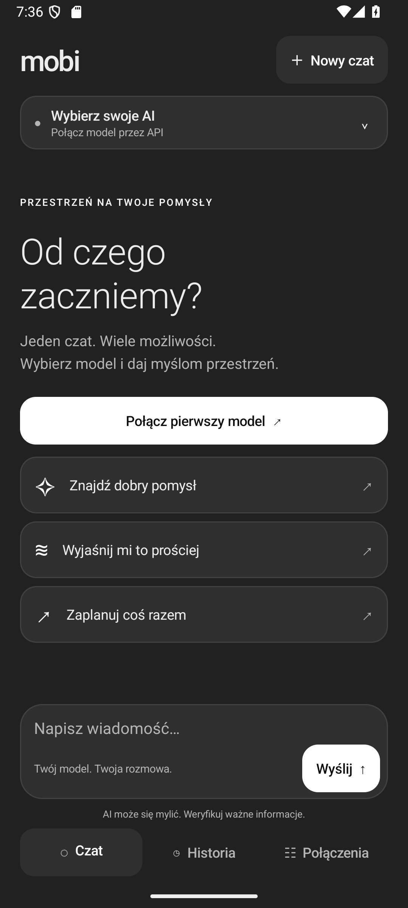
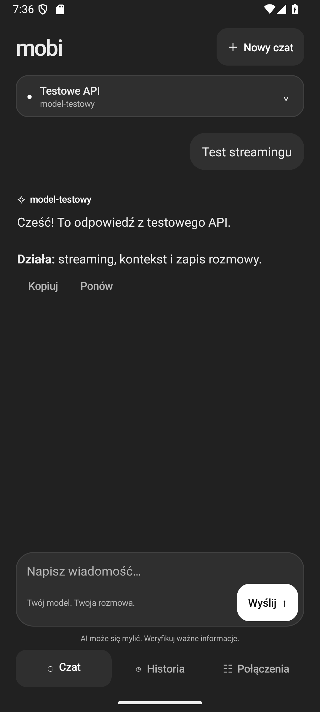
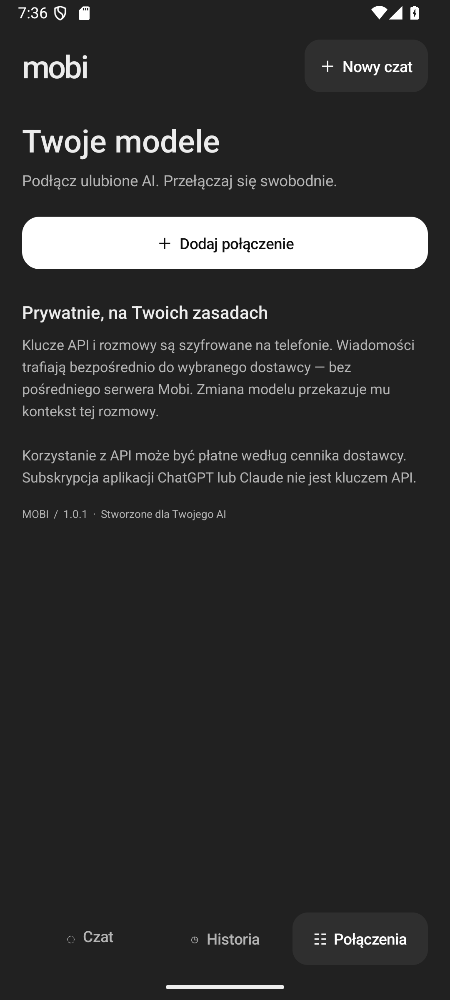

# Mobi — Twój czat AI na Androida

Natywna aplikacja Android (Java), interfejs po polsku, ciemny motyw, bez pośredniego backendu. Minimalna wersja: Android 8.0 (API 26). Kod aplikacji nie ma zewnętrznych zależności runtime.

Wersja 1.0.1 zmienia kolorystykę na neutralny ciemny motyw w stylu ChatGPT: grafitowe tło, szare powierzchnie i białe akcenty. Aktualizację APK instaluj na istniejącą aplikację, bez odinstalowywania, aby zachować połączenia i historię.

<p>
  
  
  
</p>

## Instalacja na telefonie

1. Pobierz `Mobi.apk` z [najnowszego wydania](https://github.com/aczeki/Mobi/releases/latest) i przenieś na telefon (USB, Dysk Google lub inna wybrana metoda). Suma kontrolna SHA-256 jest w pliku `SHA256.txt` przy wydaniu.
2. Otwórz plik na telefonie i zezwól wybranej aplikacji na instalację z tego źródła, jeśli Android o to poprosi.
3. Uruchom **Mobi → Połączenia → Dodaj połączenie**.
4. Wybierz dostawcę, wklej swój klucz API i wybierz **Pobierz modele z API** lub wpisz identyfikator modelu ręcznie.
5. Zapisz połączenie i rozpocznij rozmowę.

APK z katalogu `dist` jest wersją do osobistego testowania, podpisaną lokalnym kluczem debug Android SDK. Publikacja w Google Play wymaga własnego klucza wydawniczego i osobnej konfiguracji wydania. Nie odinstalowuj aplikacji podczas zwykłej aktualizacji — odinstalowanie usuwa lokalne dane.

## Obsługiwane API

| Format | Adres bazowy (przykład) | Endpoint rozmowy |
| --- | --- | --- |
| OpenAI Chat Completions | `https://api.openai.com/v1` | `/chat/completions` |
| OpenAI Responses | `https://api.openai.com/v1` | `/responses` |
| Anthropic Messages | `https://api.anthropic.com/v1` | `/messages` |
| Google Gemini | `https://generativelanguage.googleapis.com/v1beta` | `/models/{model}:streamGenerateContent` |
| OpenRouter (format OpenAI) | `https://openrouter.ai/api/v1` | `/chat/completions` |
| Ollama (format OpenAI) | `http://192.168.1.10:11434/v1` | `/chat/completions` |
| LM Studio (format OpenAI) | `http://192.168.1.10:1234/v1` | `/chat/completions` |

Możesz podłączyć dowolny **tekstowy model udostępniony w jednym z tych czterech formatów API**, także pod własnym adresem. Nie oznacza to zgodności z każdym istniejącym protokołem. API wymagające niestandardowych nagłówków, Azure-specific endpointów, AWS SigV4, narzędzi albo specjalnego uwierzytelniania wymagają dodatkowego adaptera lub bramki zgodnej z OpenAI.

Identyfikatory modeli pochodzą z API dostawcy lub są wpisywane przez użytkownika; nie ma zaszytej listy modeli, która szybko by się zdezaktualizowała. Lista `/models` może być ograniczona pierwszą stroną odpowiedzi dostawcy — brakujący identyfikator można zawsze wpisać ręcznie. Pobranie listy sprawdza endpoint i autoryzację do listy; dopiero wysłanie wiadomości sprawdza uprawnienia do generowania przez dany model.

Limit tokenów w ustawieniach jest wysyłany do Claude i Gemini. W formatach OpenAI nie narzucamy limitu ani temperatury, ponieważ nie wszystkie modele przyjmują te same parametry. Można wyłączyć streaming dla endpointów zwracających tylko pełną odpowiedź JSON.

## Funkcje

- odpowiedzi na żywo, zatrzymanie generowania i ponowienie ostatniej odpowiedzi;
- wiele zapisanych połączeń i szybkie przełączanie modeli w rozmowie;
- historia z wyszukiwaniem w tytułach i treści, zmiana nazw, usuwanie;
- kopiowanie odpowiedzi i udostępnianie tekstu rozmowy przez Android;
- proste formatowanie: nagłówki, pogrubienie, listy, cytaty, kod;
- własne instrukcje systemowe dla każdego połączenia;
- komunikaty o błędach HTTP, limitach, niedostępności i przerwanym strumieniu;
- zapis historii i kluczy API z szyfrowaniem AES-256-GCM, klucz w Android Keystore;
- brak telemetrii, konta Mobi, chmury Mobi i automatycznego backupu rozmów.

Przerwane i błędne odpowiedzi są oznaczone i pomijane razem z ich pytaniem w kontekście kolejnych zapytań. Pełne wcześniejsze rozmowy są wysyłane do aktualnie wybranego dostawcy; zmiana dostawcy w istniejącym czacie przekazuje mu ten kontekst. Długie rozmowy mogą przekroczyć okno kontekstowe modelu — wtedy rozpocznij nowy czat.

## Modele lokalne

Uruchom serwer Ollama lub LM Studio tak, aby nasłuchiwał na interfejsie LAN, i udostępnij jego port tylko w zaufanej sieci. Wpisz rzeczywisty adres IP komputera; `localhost` na telefonie oznacza sam telefon. Telefon i serwer muszą mieć wzajemny dostęp przez Wi-Fi. Włącz **Zezwól na HTTP w sieci lokalnej**. Aplikacja odrzuca publiczne adresy HTTP i nie podąża za przekierowaniami API. Lokalne HTTP jest nieszyfrowane; preferuj HTTPS, jeśli Twój serwer je obsługuje.

## Prywatność i ograniczenia

Klucze wklejaj bezpośrednio w aplikacji; nie dodawaj ich do repozytorium. Okno edycji połączenia blokuje zrzuty ekranu Androida. Historia i klucze znajdują się w zaszyfrowanym pliku w katalogu `noBackupFilesDir`. Po usunięciu aplikacji lub utracie klucza Android Keystore danych nie można odzyskać. Udostępnianie rozmowy eksportuje tekst, bez kluczy API.

Wybrany dostawca przetwarza wysłany tekst na własnych zasadach. Klucz API i jego rozliczenia są oddzielne od subskrypcji konsumenckich aplikacji ChatGPT/Claude. To wersja czatu tekstowego: bez załączników, narzędzi, generowania obrazów i rozmów głosowych. Brak automatycznego ponawiania płatnych zapytań; **Ponów** wysyła nowe zapytanie na polecenie użytkownika.

## Budowanie

Wymagane: JDK 17, Android SDK Platform 36, Build Tools 35.0.0, internet przy pierwszym pobraniu zależności. Android Studio może otworzyć katalog projektu bezpośrednio.

```powershell
# Windows; skrypt wykrywa typowe lokalizacje JDK 17 i Android SDK
.\build-android.ps1 -Test

# Dodatkowo testy na uruchomionym emulatorze
.\build-android.ps1 -Test -DeviceTest
```

Testy urządzeniowe tworzą i usuwają dane aplikacji Mobi. Skrypt wybiera wyłącznie emulator, nigdy podłączony fizyczny telefon. Uruchamia gotowy pakiet testowy przez ADB, bez dodatkowej warstwy Gradle Unified Test Platform.

Ręcznie / Linux / macOS:

```sh
# Ustaw JAVA_HOME i ANDROID_HOME lub sdk.dir w local.properties
./gradlew testDebugUnitTest lintDebug assembleDebug
```

Wynik Gradle: `app/build/outputs/apk/debug/app-debug.apk`. Skrypt PowerShell kopiuje wynik do `dist/Mobi.apk` dopiero po pomyślnym zakończeniu wskazanych testów.

## Architektura

- `MainActivity.java`: natywny interfejs, stan czatu i zadania sieciowe;
- `ApiClient.java`: cztery adaptery API, walidacja adresów, błędy i kontekst;
- `SseReader.java`: parser zdarzeń SSE;
- `Models.java`: modele danych i serializacja;
- `Vault.java`: Android Keystore + szyfrowany, atomowy zapis;
- `Markdown.java`: podstawowe formatowanie odpowiedzi;
- `ApiClientTest.java`: testy adapterów, strumieni, adresów i historii;
- `AppDeviceTest.java`: test Android Keystore, nawigacja i rozmowa HTTP z lokalnym serwerem testowym.

Dokumentacja protokołów: [OpenAI Chat Completions](https://developers.openai.com/api/reference/resources/chat/subresources/completions/streaming-events), [OpenAI Responses](https://developers.openai.com/api/docs/guides/streaming-responses), [Anthropic streaming](https://platform.claude.com/docs/en/build-with-claude/streaming), [Gemini API](https://ai.google.dev/api), [Android cryptography](https://developer.android.com/privacy-and-security/cryptography).
